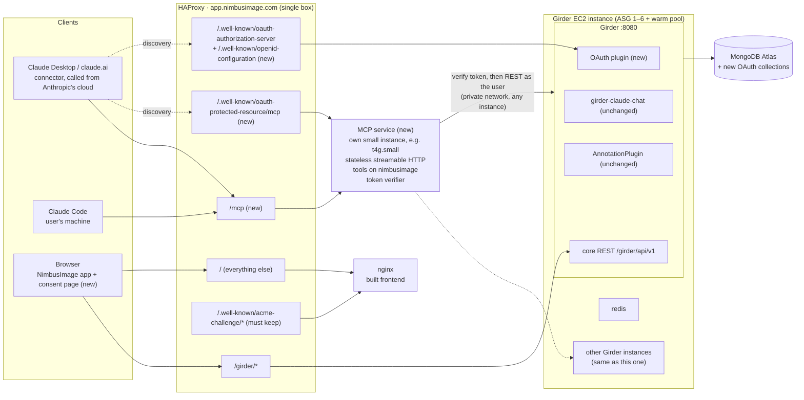
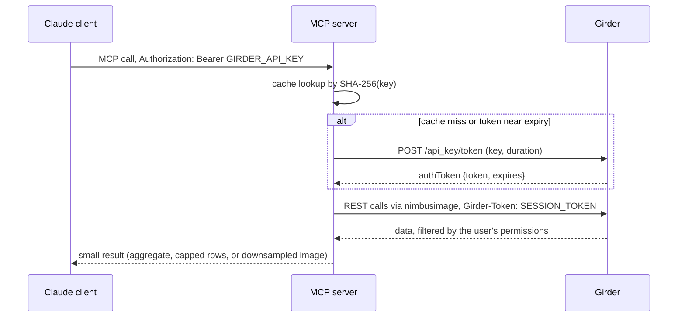
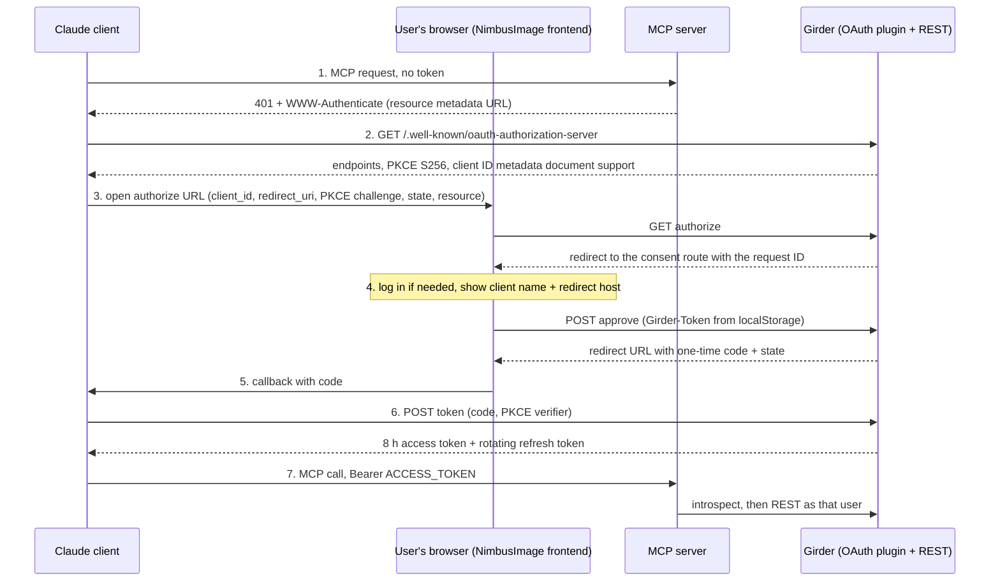

# NimbusImage MCP Server: Architecture and Implementation Plan

**Status:** Phase 1 built: the `nimbusimage-mcp/` package with per-request API-key
auth and 17 tools, run locally or as the compose `mcp` profile (see
[`nimbusimage-mcp/README.md`](../nimbusimage-mcp/README.md)). Phase 0 measurements are in
[`nimbusimage-mcp/eval/PHASE0_RESULTS.md`](../nimbusimage-mcp/eval/PHASE0_RESULTS.md).
Placement decided (2026-10-12): a small separate service, see §11. Phase 2 done
(2026-10-13): the header-key connector works from claude.ai and through `mcp-remote` behind
a local HAProxy with the proposed production rules; see
[Phase 2 results](#phase-2-results-2026-10-13). Phase 3 in progress (2026-10-13): the OAuth
plugin is built and reviewed ([6.3](#63-girder-oauth-plugin)); the verifier, consent page
and end-to-end tests are next. Phases 4 onward are proposals. The order was changed on 2026-10-12 so a header-key connector test through a
tunnel (Phase 2) comes before OAuth (Phase 3), because most users will be on Team/Enterprise
plans and OAuth must follow soon, built on a verified connector path.
**Last reviewed:** 2026-10-13 (Phase 2 routing and §7 Phase 4 rules against the
AWSDeploy HAProxy template, including its static server); otherwise 2026-10-11, against
NimbusImage `82a746f`, the AWSDeploy HAProxy template and deploy playbook, and the current Claude and MCP documentation listed in
[References](#13-references).
**Supersedes:** the architecture, auth, and implementation sections of
[`NIMBUSIMAGE_MCP_DESIGN.md`](NIMBUSIMAGE_MCP_DESIGN.md). That document's proposed tool
list is still a useful reference for tool naming.

This document records the architecture we landed on for exposing NimbusImage to Claude
through the Model Context Protocol (MCP), and the plan for getting there: a local spike
first, then a public tunnel test with API keys, OAuth, an AWS test-environment rehearsal,
and finally production.

---

## Contents

1. [Summary of decisions](#1-summary-of-decisions)
2. [Why MCP, and what "progressive disclosure" buys us](#2-why-mcp-and-what-progressive-disclosure-buys-us)
3. [Client compatibility](#3-client-compatibility)
4. [Architecture](#4-architecture)
5. [Tool surface](#5-tool-surface)
6. [Authentication design](#6-authentication-design)
7. [Implementation plan](#7-implementation-plan)
8. [Changes and blast radius](#8-changes-and-blast-radius)
9. [Test plan](#9-test-plan)
10. [Regression checklist](#regression-checklist)
11. [Open decisions](#11-open-decisions)
12. [Assumptions and things not yet verified](#12-assumptions-and-things-not-yet-verified)
13. [References](#13-references)

---

## 1. Summary of decisions

| Topic | Decision |
|---|---|
| What we build | A standalone MCP server that wraps the `nimbusimage` Python package. |
| Relationship to the in-app AI panel | Separate surface. `girder-claude-chat` is **not modified**. We borrow design patterns and copy useful tool definitions, but we do not mirror its tool list. |
| Transport | Streamable HTTP in **stateless** mode, served at `/mcp` behind HAProxy. |
| Placement | A **small separate service**: the MCP container on its own instance (e.g. EC2 t4g.small), behind HAProxy, calling Girder over the private network. Not a sidecar on every Girder host, not inside Girder. See [11](#11-open-decisions). |
| Identity | Every tool call runs as the calling user. Girder's existing access control decides what anyone can see or change. The MCP server never holds a privileged credential. |
| Auth, individuals | A personal Girder API key sent as a bearer header. Works for Claude Code and for Pro/Max custom connectors. |
| Auth, teams | OAuth 2.1, with **Girder as the authorization server** (a new Girder plugin) and the MCP server as a resource server only. Needed because Team/Enterprise connector headers are shared by every member. |
| Context discipline | Discoverable tool names and descriptions for client-side tool search, plus small results: aggregates before rows, hard row caps, downsampled images. |
| Order of work | Local spike, then local production-shape server (both done), then a header-key connector test through a tunnel, then OAuth (local, then through the tunnel), then an AWS test-environment rehearsal, then production. |

---

## 2. Why MCP, and what "progressive disclosure" buys us

There are two different kinds of context bloat, and they need different fixes.

| Kind of bloat | What it is | What fixes it |
|---|---|---|
| Tool definitions | Tool schemas sitting in context on every turn | Tool search with deferred loading |
| Tool results | Raw annotation rows, property values, and images coming back from calls | Aggregates, row caps, query-based mutations, downsampled images |

The `nimbusimage` API and the in-app AI panel were designed around the second kind. That
discipline still matters and carries straight over to the MCP tools.

Tool search addresses only the first kind. Per Anthropic's tool search documentation:

- It pays off at 10 or more tools, or more than 10K tokens of definitions.
- Tool selection accuracy degrades past roughly 30 to 50 loaded tools.

The in-app agent already has 38 tools (about 8.8K tokens), and `nimbusimage` has about 163
public methods. A useful MCP surface will sit past those thresholds.

**Who does the deferring.** Deferral is decided by whoever owns the model call:

- Claude Code and Claude Desktop manage MCP tool loading themselves.
- Our job as the server author is to make tools **findable**. Search covers tool names,
  descriptions, argument names, and argument descriptions.
- So: use a consistent `ni_` prefix and write descriptions in the words users actually say
  ("count spots", "nuclei", "z-stack", "segment cells"), not in method names.

---

## 3. Client compatibility

Verified against the sources in [References](#13-references) on 2026-10-09 and 2026-10-11.

| Client | Where the connection comes from | Auth options | Notes |
|---|---|---|---|
| Claude Code | The user's machine | Static header (`--header`), or OAuth with dynamic registration, Client ID Metadata Documents, or a pre-registered client (`--client-id`, `--client-secret`, `--callback-port`) | Config is per user, so each person uses their own key. Can reach `localhost`. |
| Claude Desktop and claude.ai custom connector, Pro/Max | **Anthropic's servers** | "No sign in" plus fixed request headers, or OAuth | Server must be publicly reachable over HTTPS. Header values are stored encrypted. |
| Same, Team/Enterprise | Anthropic's servers | OAuth per member, or a fixed header **shared by every member** | Only Owners (and, on Enterprise, roles with library management) can add connectors. A shared header makes everyone the same Girder user, so OAuth is required for teams. |
| Claude Desktop config file | The user's machine | `mcp-remote` bridge with `--header` | Needs Node 18 or later. Useful for local or self-hosted installs that are not public. |
| Desktop Extension (`.mcpb`) | The user's machine | `user_config` field with `sensitive: true`, injected as an environment variable | Local servers only (node, python, uv, binary). Fallback option, not the main path. |
| Messages API MCP connector | Anthropic's servers | `authorization_token` string | Beta. Not covered by zero data retention. Not used in this plan. |

Relevant spec facts (MCP authorization, 2025-11-25):

- Authorization is optional. When an HTTP server implements it, it should follow OAuth 2.1
  and must publish Protected Resource Metadata (RFC 9728).
- Dynamic Client Registration is optional and kept for backwards compatibility. Clients
  should prefer pre-registered credentials, then Client ID Metadata Documents, then dynamic
  registration.

---

## 4. Architecture

### 4.1 Topology



Key properties:

- **One path in.** Every MCP client reaches the server through HAProxy at `/mcp`.
- **The user's identity flows through.** The MCP service builds a `nimbusimage` client per
  request with the caller's own Girder token. It holds no admin or service credential.
- **Stateless.** HAProxy round-robins across Girder instances, and MCP clients do not keep
  HAProxy's `SERVER` sticky cookie. Every request must be servable by any instance.
- **Discovery documents live at fixed root paths.** RFC 9728 and RFC 8414 put metadata
  under `/.well-known/`, which today falls through to nginx, right beside the ACME
  certificate-renewal path.

### 4.2 Components

| Component | Role | Where it lives |
|---|---|---|
| MCP server | Exposes `ni_*` tools over streamable HTTP. Serves Protected Resource Metadata and the 401 challenge (the MCP Python SDK does both automatically when auth is configured). | `nimbusimage-mcp/` at the repo root; container image in ECR, run on its own small instance |
| Token verifier | Accepts a Girder API key or an OAuth access token, resolves it to a Girder session token and user. | Inside the MCP server |
| Girder OAuth plugin | Authorization server: metadata, authorize, consent (request, approve, deny), token, revoke, the user's connections, and an introspection endpoint for the MCP service. Off by default behind a setting. | `devops/girder/plugins/McpOAuthPlugin/` (built, Phase 3) |
| Consent page | Frontend route that shows who is asking and approves the request with the user's own Girder token. | NimbusImage frontend (`src/views/`, router) |
| HAProxy rules | Exact-path routes for `/mcp` and the two OAuth discovery documents; a static backend for the MCP service. | AWSDeploy `templates/startup_haproxy.tftpl` (the IP manager script should need no change; confirm with a test) |

### 4.3 API-key request path



Girder's `POST /api_key/token` is a public endpoint that exchanges a key for a session
token. Without caching, every MCP call would mint a new Girder token (see
[side effects](#62-side-effects-to-plan-for)).

### 4.4 OAuth request path (Team/Enterprise)



**Why consent must be a frontend page.** The frontend stores the Girder session token in
`localStorage` under `nimbus.girderToken` (see `src/store/index.ts`), not in a cookie. A
top-level browser redirect to a Girder endpoint carries no credential, so the server cannot
tell who is logged in. The consent page reads the token in the browser and sends it with
the approve call.

---

## 5. Tool surface

### 5.1 Principles

- **Names:** `ni_{noun}_{verb}`, as proposed in `NIMBUSIMAGE_API.md`. One prefix lets a
  single search match the whole family.
- **Descriptions:** say what the user would say, and say what comes back and how big it is.
  Example: "Count annotations in a dataset, optionally by shape or tag. Returns one number.
  Use this before listing annotations."
- **Results stay small:**
  - Aggregates first: counts, summaries by tag and shape, property statistics.
  - Raw rows are capped at 200 per call, matching the AI panel's `MAX_LIST_ANNOTATIONS`.
    Responses past the cap say so and point to the summary tool.
  - Images are downsampled to a `max_size` (default 1024 px on the long side) and returned
    as MCP image content.
  - Long jobs return a job ID immediately. A separate `ni_job_wait` tool waits with a
    timeout well under the HTTP request timeout.
- **Mutations are explicit.** Mark tools with MCP tool annotations (`readOnlyHint`,
  `destructiveHint`) so clients can ask before running them. Prefer query-based mutations
  ("tag all polygons with tag X") over ID lists.
- **Stateless:** every tool takes `dataset_id`. No "current dataset" session state.
- **Memory, not just context:** some `nimbusimage` calls fetch full sets into the MCP service
  (for example `annotations.list(limit=0)`). That never reaches the model, but it does use
  MCP service memory. Prefer `count` and server-side filters, and always pass a limit.

### 5.2 What to borrow from the in-app agent, and what not to

`girder-claude-chat` is a thin Girder wrapper around Claude API calls: it adds the API key,
system prompt, tool definitions, and rate limiting. Its 38 tools are JSON schemas whose
executors run **in the browser** against the live Vuex stores (`src/agent/executors.ts`).
An MCP server has no open viewer.

| AI panel tools | MCP server |
|---|---|
| `get_annotation_summary`, `list_annotations`, `list_properties`, `get_property_values`, `get_property_histogram`, `get_sample_values`, `list_workers`, `get_worker_interface`, `run_worker`, `compute_property`, `create_property`, `wait_for_job`, `tag_annotations`, `read_help_topic` | **Rebuild server-side** with `nimbusimage`, taking `dataset_id`. Reuse the schema shapes and description wording where they fit. |
| `get_interface_state`, `capture_screenshot`, `set_location`, `set_camera`, `set_layer_mode`, `update_layer`, `set_layer_visibility`, `set_display_options`, `set_view_mode`, `select_annotations`, `set_annotation_filter`, `select_tool`, plot tools | **Leave out.** They only make sense inside an open browser tab. |

Patterns worth copying: the shared annotation `query` sub-schema, summaries before rows,
the row cap, and the read-versus-gated-write split. **Copy** tool definitions into the MCP
package instead of importing them from the chat plugin, so the two surfaces can change
independently.

**Help topics are the exception (decided in Phase 1).** `ni_help_topic` reads the articles
over REST from the chat plugin's `GET claude_agent/help?topic=` endpoint, as the caller.
The articles document the app, not either surface, and are edited often; a copy of about
100 KB of markdown would drift. The MCP server only reads the endpoint and changes nothing
in the plugin. The topic list is kept in the tool; an unknown topic gets the endpoint's own
400, which lists the current topics. Reading help needs a key with `core.user_auth`.

### 5.3 Spike tool set (read-only)

| Tool | Wraps | Returns |
|---|---|---|
| `ni_datasets_list` | `client.list_datasets()` | `[{id, name}]`, capped and trimmed. The underlying call returns full folder documents. |
| `ni_dataset_info` | `client.dataset(id)` | Name, shape, channels, frame counts, pixel size |
| `ni_annotations_count` | `ds.annotations.count(shape, tags)` | One number |
| `ni_annotations_summary` | counts by shape and tag | Small table |
| `ni_image_get_composite` | `ds.images.get_composite(xy, z, time)` | Downsampled PNG |

### 5.4 Phase 1 tool set (built)

The spike's five tools, changed as the spike recommended: `ni_datasets_list` caps at 100,
`ni_annotations_count` takes up to 50 `dataset_ids` and counts them in one request to
`POST upenn_annotation/counts` (one eval task had needed 16 calls),
`ni_annotations_summary` takes shape and tag filters, and every text result is compact
JSON with no structured copy (the SDK's default indents dicts and duplicates them as
`structuredContent`). Added:

| Tool | Wraps | Notes |
|---|---|---|
| `ni_annotations_list` | `ds.annotations.list(limit, offset)` + `count` | Max 200 rows; center and vertex count instead of coordinates |
| `ni_annotations_tag` | `list`/`get_many` + `update_many` | **Destructive hint.** Query-based (`match_shape`, `match_tags`) or ids; a filter is required; max 10,000 annotations; undoable in the app |
| `ni_image_get_channel` | `ds.images.get` | One channel, grayscale, 0.5–99.5 percentile stretch (spike wish list) |
| `ni_properties_list` | configuration `propertyIds`, `uncomputed_counts`, a value sample | Properties of the caller's default view's configuration, as the app and `nimbusimage` resolve them. Uncomputed counts are exact; value paths come from a bounded sample of value documents (both ends), as the app's lazy mode does, so a sparsely computed property can show none |
| `ni_property_values_summary` | `ds.annotations.summary(property_paths=…)` | count, mean, std, min, max per path; shape and tag filters |
| `ni_property_histogram` | `ds.properties.histogram` | The server's bins hold equal counts; the description says so |
| `ni_property_compute` | `ds.properties.compute` | **Destructive hint.** Not in the original list; without it a "measure X" request dead-ends |
| `ni_workers_list` | `client.list_workers()` | Roles from marker labels by presence (a worker can have both); base images and `:test` tags hidden by default |
| `ni_worker_interface` | `get_worker_interface` (+ registration job; whole call at most 60 s and the job-wait cap) | Parameters, value formats, and the dataset's channels |
| `ni_worker_run` | `ds.annotations.compute` | **Destructive hint.** Annotation workers only; parameters normalized like the app (`worker_values.py` ports `src/utils/workerInterface.ts`) |
| `ni_job_wait` | `client.job(id)` + `refresh()` | Async; at most `NI_MCP_MAX_JOB_WAIT` (240 s); reports `finished: false` instead of failing, `status: "unknown"` if Girder does not answer in time, or the last known state with a note if Girder stops answering mid-wait |
| `ni_help_topic` | `GET claude_agent/help` | See 5.2 |

---

## 6. Authentication design

### 6.1 Token verifier (in the MCP server)

Uses the MCP Python SDK's resource-server pattern: a `TokenVerifier` subclass plus
`AuthSettings(issuer_url=…, resource_server_url=…, validate_token_resource=True)`. The SDK
then serves `/.well-known/oauth-protected-resource/mcp` and returns the 401 challenge on
unauthenticated requests. Per the SDK docs, the older option of embedding an authorization
server inside the MCP server should not be used for new servers.

The verifier accepts two credential types:

1. **Girder API key.** Exchange it with `POST /api_key/token`. Cache the resulting session
   token keyed by `SHA-256(key)` until shortly before it expires. Never log the key.
2. **OAuth access token.** Call the OAuth plugin's internal introspection endpoint, which
   returns the user, client, scopes, `resource`, and the Girder session token to use. Set
   `AccessToken.resource` from the grant so the SDK's resource check works.

The verifier tries the cheap check first by token shape, then falls back to the other.
Anything that fails both returns `None`, which the SDK turns into a 401.

### 6.2 Side effects to plan for

- **Admin metric inflation.** `GET /api/v1/system/authenticated_users` counts users who
  had a token created in the window. API-key exchanges and OAuth refreshes both mint Girder
  tokens, so MCP users will appear as "authenticated" more often. Note this next to the
  metric's documentation in `CLAUDE.md` when MCP ships.
- **Token collection growth.** Uncached exchanges would mint one token per call. Caching
  is a requirement, not an optimization.
- **Refused keys are not cached.** Each request with an unknown key costs Girder one
  lookup (exchanges for different keys run in parallel, so a flood does not block other
  users' sign-ins). Rate-limit 401s at HAProxy when the route goes public (Phase 4); a
  negative cache in the MCP service would not survive round-robin across instances anyway.

### 6.3 Girder OAuth plugin

**Built (Phase 3, 2026-10-13):** `devops/girder/plugins/McpOAuthPlugin/`, package
`nimbus_mcp_oauth`, installed in `devops/girder/Dockerfile`; backend CI runs its tox. Code is
split as the backend rules ask: `oauth.py` and `clients.py` hold the logic and raise
`OAuthError`, `rest.py` maps that to HTTP. 70 tests, one or more per rule below; the PKCE,
refresh-reuse, resource and `redirect_uri` checks were each confirmed to fail their test
when disabled.

**Decisions (2026-10-13):**

| Question | Decision | Why |
|---|---|---|
| Client registration | Client ID Metadata Documents, fetched only from `claude.ai` and `claude.com`, plus one built-in public client (`nimbusimage-claude`). No dynamic registration, no secrets. | "Use Claude's published identity" is the connector dialog's recommended option and Claude Code's default; the 2026-07-28 MCP spec deprecates dynamic registration. Restricting hosts keeps the server-side fetch from becoming SSRF. |
| Scope | One scope, `nimbusimage`: full access, the same as a full-access API key | Every tool works, including job waits (which need `core.user_auth`); the consent page says so plainly |
| Lifetimes | Access 8 h; refresh 30 days idle, rotated on every use | Each access token mints one Girder session (about 3 a day per active user); revoking a connection takes effect on the next call because the MCP service introspects every request |
| Login on the consent page | Save the in-app return path in `sessionStorage`, send the user to the root page's login, return after login | Verified live on app.nimbusimage.com: Outseta returns to the root with `?access_token`, `sessionStorage` survives the round trip, and the session survives a reload. No OutsetaComponents change. |

**Setting:** `mcp_oauth.enabled`, default **false**. When false, every endpoint (and the
metadata document) returns 404. This matters because merging into NimbusImage master
deploys to production on the next autoscaling churn (see
[Phase 6](#phase-6-production-rollout)). Other settings: `mcp_oauth.issuer` (the bare
origin, equal to the MCP server's `NI_MCP_ISSUER_URL`), `mcp_oauth.api_url` (public Girder
REST root, e.g. `https://app.nimbusimage.com/girder/api/v1`), `mcp_oauth.frontend_url`,
`mcp_oauth.resources` (the MCP URLs a token may be for), `mcp_oauth.introspection_secret`
(32+ characters; empty disables introspection), `mcp_oauth.cimd_hosts`.

**Endpoints** (REST under `/api/v1/mcp_oauth`):

| Endpoint | Access | Purpose |
|---|---|---|
| `/.well-known/oauth-authorization-server` (server root, mounted in CherryPy) | Public | RFC 8414 metadata: S256 only, `token_endpoint_auth_methods_supported: ["none"]`, `client_id_metadata_document_supported`, `authorization_response_iss_parameter_supported` |
| `GET authorize` | Public, 30/min per address | Validate client, redirect URI, PKCE, `resource`, scope; store a pending request (10 min); redirect to `#/oauth/consent?request=<id>`. An untrusted client or redirect URI gets a 400, never a redirect; later errors redirect back with `error`, `state` and `iss`. |
| `GET request/:id` | User | Client name, redirect host, whether it is a local redirect |
| `POST request/:id/approve`, `/deny` | User (Girder token header), 30/min per user | Single use; approve issues a 60 s one-time code and returns the redirect URL (`code`, `state`, `iss`) |
| `POST token` | Public, form-encoded, flood cap per address | `authorization_code` (PKCE verifier, same client, same redirect URI, `resource` if sent) and `refresh_token` (rotation; reuse or another client revokes the connection). OAuth-shaped errors, including 429. |
| `POST revoke` | Public, same cap as `token` | RFC 7009; either token ends the connection |
| `POST introspect` | Shared secret header (`X-Mcp-Introspection-Secret`), else 404; hidden from the API docs | For the MCP service: active, user, client, scope, resource, expiry, and the Girder session token to act with |
| `GET grant`, `DELETE grant/:id` | User | Your connected clients; disconnect (UI later) |

`token`, `revoke` and `introspect` are kept out of Girder's audit log, which records every
parameter.

**Collections** (all with TTL indexes on `expiresAt`): pending requests, codes, grants (one
per connection, expiry slides on refresh), access tokens, refresh tokens, and a one-hour
cache of fetched client documents. Codes, access and refresh tokens are stored only as
SHA-256 hashes; an access token's record holds the id of the Girder session behind it.

**Tokens:**

- Access token: `nio_` + 43 random characters, standing for a Girder session token
  (`Token().createToken(user, days=8/24, scope=TokenScope.USER_AUTH)`). Revoking the
  connection deletes those sessions.
- Refresh token: `nir_` + 43 random characters, **rotated on every use**. Reuse of an old
  one revokes the whole connection, so a client that retries a refresh after a network
  error loses the connection (by design) and the user reconnects.

**Clients:** the built-in client allows Claude's callbacks
(`https://claude.ai/api/mcp/auth_callback`, and the `claude.com` variant as a hedge) and
Claude Code's loopback callback, `http://localhost/callback` or `http://127.0.0.1/callback`
on any port (RFC 8252). A client document is fetched over
https from an allowed host only, without redirects, within 5 s and 64 KB; its `client_id`
must equal its URL, it must be a public client, and its `redirect_uris` may only be Claude's
callbacks or loopback, so JSON served anywhere on an allowed host cannot send codes to
another host.

**Security requirements (each has a test):**

- PKCE with S256 required; plain is rejected.
- Exact redirect URI match against the registered list; the only leeway is the loopback
  port.
- Authorization codes expire in 60 seconds and work once; a replayed code revokes what it
  issued.
- `state` is passed through unchanged, and `iss` is returned (RFC 9207).
- The `resource` parameter is required and must equal a configured MCP server URL
  (compared in canonical form).
- Refresh tokens rotate; reuse or a different client revokes the connection; a missing
  `client_id` or (from the right client) a non-matching `resource` is an error that does
  not spend the token.
- Disabled, unapproved or unverified accounts cannot exchange, refresh or introspect.
- `authorize`, consent and `token` are rate-limited (the limiter is copied from
  `girder-claude-chat/girder_claude_chat/rate_limit.py`, not imported).
- The consent screen shows the client name and the redirect host (consent page, next).
- Return-after-login accepts only in-app routes, never external URLs (consent page, next).

**Known limits:**

- A narrow race can leave a Girder session token nobody holds (it expires in 8 h).
- Consent requests are not bound to the browser that started them; a forwarded authorize
  link is stopped by the client's own `state` check. The consent page should refuse to be
  framed and tell users to approve only a request they just started.
- The session behind an access token has full access, so it could mint an API key that
  outlives the connection; the MCP tools never do this.
- The rate limits are per process. Authorize, token and revoke are keyed on the last
  `X-Forwarded-For` hop (correct only behind HAProxy, which is how production runs);
  consent is keyed per user.

---

## 7. Implementation plan

Each phase ends with explicit exit criteria. Do not start the next phase until they are met.

### Phase 0: Spike

**Goal:** find out whether an MCP server over `nimbusimage` is actually useful, as cheaply
as possible. The code may be thrown away. What we keep is the answers.

**Scope:**

- The five read-only tools in [5.3](#53-spike-tool-set-read-only).
- Single-user auth: the server reads `NI_API_URL` and `NI_API_KEY` from the environment
  (already supported by `ni.connect()`), binds to `127.0.0.1` only, and has no auth on the
  MCP endpoint itself.
- Runs on the host against the local compose stack. No container, no OAuth, no HAProxy.

**Steps** (as run; the spike code has since been replaced by the Phase 1 package, so
`spike/server.py` no longer exists):

```bash
# 1. Local backend (repo root)
docker compose up -d                 # Girder at http://localhost:8080
# 2. Create an API key for a local user: Swagger at http://localhost:8080/api/v1, POST /api_key
# 3. Server env
python3 -m venv .venv && source .venv/bin/activate
pip install -e nimbusimage "mcp[cli]"          # pin the SDK version once chosen
# 4. Run the spike server (MCPServer from mcp.server, streamable-http, stateless_http=True)
NI_API_URL=http://localhost:8080/api/v1 NI_API_KEY=<key> python spike/server.py
# 5. Connect clients
claude mcp add --transport http --scope local nimbus-local http://127.0.0.1:8000/mcp
npx @modelcontextprotocol/inspector             # optional: call tools by hand
```

**Measure on 10 to 15 real tasks** (for example "how many nuclei in dataset X", "show me
the composite for z=3", "which datasets have spot annotations"):

- Did Claude pick the right tool first?
- Response size per call (log bytes; divide by about 4 for tokens).
- Latency per call, especially image composites.
- Which tools did you wish existed?

**Exit criteria:**

- [x] Claude Code completes most tasks without hand-holding.
- [x] No single tool response is larger than about 2K tokens, except images.
- [x] A written list of tools to add, rename, or drop.
- [x] A decision on the open placement question in [11](#11-open-decisions), informed by
      how heavy the server process is. (Spike input: light, ~100 to 230 MB; the decision
      still needs the in-process option tried.)

### Phase 1: Production-shape server with API-key auth (local)

**Goal:** the real server, still local, with per-request credentials.

**Work:**

- New package `nimbusimage-mcp/` with its own `pyproject.toml` (depends on `nimbusimage`
  and a pinned MCP SDK). Keeps the SDK out of `nimbusimage`'s dependencies.
- Token verifier for API keys with the exchange cache ([6.1](#61-token-verifier-in-the-mcp-server)).
- Phase 1 tools ([5.4](#54-phase-1-tool-set-built)), result caps, image downsampling, and
  `ni_job_wait` with a timeout.
- Error mapping: `girder_client.HttpError` 401/403/404 become clear tool errors, never
  stack traces.
- Container image and a `mcp` service in `docker-compose.yaml` under a compose **profile**
  so default `docker compose up` is unchanged.
- Basic structured logging: tool name, duration, response size, user ID. Never tokens.

**Tests:**

- Unit tests with mocked `nimbusimage` calls, following `nimbusimage/tests/` conventions.
- Integration tests against the local stack, marked `@pytest.mark.integration`, like
  `nimbusimage/tests/integration/`.
- HTTP-level auth tests with a real HTTP client. The SDK's in-memory test client skips
  auth, so it cannot prove the verifier works.

**Exit criteria:**

- [x] Claude Code works with `--header "Authorization: Bearer <key>"` against the
      container.
- [x] Two local users with different datasets each see only their own data.
- [x] Missing, invalid, and revoked keys all return 401. Deactivating a key counts as
      revoking it: Girder removes the key's tokens either way.
- [x] The exchange cache is hit on repeat calls (token count in Mongo does not grow per
      call).
- [x] All unit and integration tests pass.

**Eval against the container (2026-10-11):** the 13 Phase 0 tasks plus 6 for the new tools
(`nimbusimage-mcp/eval/tasks.txt`), headless Claude Code with only the MCP tools and a
bearer key: 19 of 19 completed, 55 calls, 0 errors, and the first real call was the right
tool every time. The "which kidney dataset has the most annotations" task took one
multi-dataset count instead of 16. Text responses: median under 1 KB, largest 6.2 KB
(`ni_workers_list`; a help article is 3 to 11 KB by design). A grayscale channel of a noisy
frame can reach about 550 KB of JPEG even at 1024 px, since stretched camera noise
compresses badly; the model's image cost depends on pixel size, not bytes. The container
sat at about 240 MB.

**What Phase 1 learned:**

- Each MCP request costs one extra Girder read (`GET token/current`) to re-check the cached
  session. That check is what makes revocation immediate; without it a deleted key would
  keep working until its cached session expired.
- A scoped API key without `core.user_auth` cannot poll jobs or read help topics, and
  Girder answers 401. Because the verifier has just checked the session, the tools report a
  mid-call 401 as a likely missing scope, not as an expired session.
- Deleting a dataset folder does not delete its annotations; the integration tests delete
  theirs explicitly.

### Phase 2: Header-key connector test (local machine, public URL)

**Goal:** prove the real claude.ai and Desktop connector path with what already exists (API
keys) before building OAuth on top of it. Moved ahead of OAuth on 2026-10-12: most users
will be on Team/Enterprise plans, so OAuth is next, and its design should rest on a
verified connector path (headers reach the server, stateless serving works, images render,
latency is acceptable, the proposed HAProxy rules behave).

**Work:**

- Run the stack in the production shape: the `mcp` compose service as the separate MCP
  service, and a local HAProxy in front with the **proposed production rules**, so this
  also rehearses Phase 4's routing. Expose only that HAProxy through a tunnel
  (cloudflared or ngrok).
- Test as a Pro/Max user with "No sign in" plus an `Authorization: Bearer <key>` header.
- Test Desktop's config file through `mcp-remote` with a header.
- Note anything about connector behaviour that the OAuth design must account for
  (callback URL, which discovery documents the connector requests, resource indicator).

**Safety:**

- The local stack uses the default `admin`/`password` and is shared, so Girder must not be
  reachable through the tunnel at all (the local HAProxy refuses it), and the connector
  uses a dedicated non-admin test user's key over test data only. (The original plan, a
  changed admin password and a throwaway database, was replaced by this on 2026-10-12
  because the local database is shared with other work.)
- Shut the tunnel down when done, and delete the test user, its key, data and jobs.

**Exit criteria:**

- [x] Header-key connector works from claude.ai and Desktop (tools listed, a count, a
      composite image, a worker run with `ni_job_wait`). Desktop's config-file path was
      tested as `mcp-remote` with `--header` under headless Claude Code (the same stdio
      bridge Desktop launches); a connector added on claude.ai is account-wide.
- [x] `/.well-known/acme-challenge/*` still routes to the static server in the local
      HAProxy.
- [x] Connector observations written down for Phase 3.

#### Phase 2 results (2026-10-13)

**Setup.** `nimbusimage-mcp/deploy/local-haproxy/` holds an HAProxy 3.2 config that copies
the production frontend (timeouts, the Girder backend's path rewrite) plus the proposed MCP
rules, a static nginx standing in for the static server, and a compose file that joins the
main stack's network. A Cloudflare quick tunnel (`cloudflared tunnel --url
http://localhost:8090`) exposed only that HAProxy. Local differences: TLS ends at the
tunnel (`X-Forwarded-Proto` stands in for `ssl_fc`), Girder is refused (403) to anything
arriving through the tunnel because the shared local stack keeps the default admin
password, and the worker rate limit is left out. Instead of a separate database, the test
ran as a dedicated non-admin user with a random password and a full-access key, owning one
copy of a 4-channel, 7-z HCR dataset; the user, key, dataset, annotations and jobs were
deleted afterwards. The compose `mcp` service now takes `NI_MCP_PUBLIC_URL`,
`NI_MCP_ISSUER_URL` and `NI_MCP_MAX_JOB_WAIT` from the environment.

**Results.**

| Client | Tools listed | Composite | Count | Worker + `ni_job_wait` |
|---|---|---|---|---|
| claude.ai custom connector ("No sign in" + `Authorization` header) | 17 | yes | yes | yes (257 spots), plus an 85 s wait |
| `mcp-remote` + `--header` (Desktop config shape), headless Claude Code | 17 | yes | yes | yes (578 spots) |
| Claude Code `--transport http` + header | 17 | yes | yes | yes |

Routing checked with and without HTTPS: plain HTTP to `/mcp` and both metadata paths
redirects to HTTPS; `/.well-known/acme-challenge/phase2-test` is served by the static
server over plain HTTP and HTTPS; `/.well-known/oauth-authorization-server` and
`/.well-known/openid-configuration` reach Girder (404; the plugin serves only the first, and
the second stays 404 on purpose); other unknown paths get
the static server's `index.html`, as in production; every other Girder path is refused
(403) through the tunnel, `//girder/` included.

**Connector observations (for Phase 3 and 4).**

- **Discovery order.** When a connector is added, claude.ai probes from `python-httpx`,
  `MCP-Protocol-Version: 2025-11-25`: an unauthenticated `POST /mcp` (401), then
  `GET /.well-known/oauth-protected-resource/mcp` (the URL in the challenge), then
  `GET /.well-known/oauth-authorization-server` and
  `GET /.well-known/openid-configuration`, both at the **root**, because the advertised
  issuer had no path. It does this even for a "No sign in" connector, and the 404s did
  not stop it. Production's static server answers any unknown path with `index.html` and
  a 200 (`try_files $uri /index.html`), so `openid-configuration` must be routed to Girder
  too (404), or claude.ai would get HTML where it expects JSON; the local static server
  now has the same fallback, and that route is in the Phase 4 rules. Phase 3 consequences: the issuer should be the bare origin
  (`https://app.nimbusimage.com`), and the OAuth plugin must answer
  `/.well-known/oauth-authorization-server` at Girder's **root**, not under `/api/v1`,
  since HAProxy passes that path through unchanged.
- **Protected Resource Metadata path.** The SDK serves it at the path-suffixed URL
  `/.well-known/oauth-protected-resource/mcp` (RFC 9728 §3.1, resource `<origin>/mcp`), and
  that is what the challenge and the connector use. The original Phase 4 rule (exact
  `/.well-known/oauth-protected-resource`) would have sent it to the static server; fixed
  below.
- **Tool calls** come with `User-Agent: Claude-User` and `MCP-Protocol-Version:
  2026-07-28`, which the pinned SDK accepts. Every call is a plain JSON `POST /mcp`; the
  connector opened no `GET /mcp` stream and kept no cookie, so stateless serving is what it
  needs. (Claude Code and `mcp-remote` do open a `GET /mcp` stream; with production
  timeouts HAProxy held them 75 to 120 s, until the client closed them.)
- **Latency.** Server time per call was 6 to 30 ms for reads, 0.45 s for a 280 KB composite
  image, 1.5 to 3 s for worker interface and run calls.
- **Long calls.** claude.ai waited out an 85 s `ni_job_wait`. Production HAProxy timeouts
  held a 229 s call. A Cloudflare tunnel does **not**: it returns 524 after 100 s without
  response headers, and the server (`json_response=True`) sends none until the tool
  returns. Keep `NI_MCP_MAX_JOB_WAIT` under every proxy timeout in front (85 for a
  tunnel); claude.ai's own limit above 85 s is unmeasured.
- **Header auth** reached the server unchanged from both claude.ai and `mcp-remote`.
- **Not observed:** the OAuth callback URL and whether the connector sends a `resource`
  parameter. Both need the Phase 3 flow.
- **Quick tunnels expire.** A `trycloudflare.com` tunnel left overnight was gone the next
  morning ("Tunnel not found"), and the connector reported "Couldn't reach this address".
  Start a fresh one per session; its URL changes, so recreate the `mcp` service with the
  new `NI_MCP_PUBLIC_URL`.
- **Found by the test, fixed elsewhere:** `nimbusimage`'s `job.log` was always empty, so
  `ni_job_wait` returned an empty `log_tail` (PR #1352). Once logs flow, a worker's first
  line carries a live Girder token; #1352 now redacts it in `job.log`.

### Phase 3: OAuth (local, then through the tunnel)

**Goal:** the full OAuth flow working end to end, first on a laptop, then through the
Phase 2 tunnel with a Team or Enterprise org.

**Work:**

- The Girder OAuth plugin ([6.3](#63-girder-oauth-plugin)), with `mcp_oauth.enabled`
  default false. Enable it in the local `girder.env` or via settings.
- Verifier support for OAuth access tokens via the internal introspection endpoint.
- Consent page at `#/oauth/consent?request=<id>` and return-after-login. API calls go in
  `src/store/GirderAPI.ts`, not in the component, per `CLAUDE.md`.
- The built-in public client `nimbusimage-claude` (done).

**Progress:** the plugin is built and reviewed (two independent review rounds; see
[6.3](#63-girder-oauth-plugin)). Next: the MCP server's verifier (`nio_` tokens via
introspection, setting `AccessToken.resource` from the response), then the consent page.

**Tests:**

- Plugin tests with pytest via tox: one or more per security requirement in
  [6.3](#63-girder-oauth-plugin), plus the disabled-setting 404s (done: 70 tests in
  `nimbus_mcp_oauth/test/`).
- Vitest for the consent page and the return-target validation.
- End to end with Claude Code:
  `claude mcp add --transport http …` (its default client document) or with
  `--client-id nimbusimage-claude --callback-port <port>`, then `/mcp` to log in.
- End to end with the MCP Inspector's OAuth flow.
- Manual: revoke a grant and confirm the next MCP call fails.

Then repeat through the Phase 2 tunnel: an Owner of a Team or Enterprise org adds the
connector with OAuth, and two members use it.

**Exit criteria:**

- [ ] Claude Code completes OAuth against the local stack and calls tools as the right user.
- [ ] Refresh works, and refresh-token reuse revokes the grant.
- [ ] With the setting off, every OAuth endpoint returns 404 and API-key auth still works.
- [ ] Security review of the plugin (use the repo's `/security-review` skill plus a human
      read).
- [ ] OAuth connector works through the tunnel, and two members of the same org see
      different data.


### Phase 4: Deploy preparation

**Goal:** all deploy-side changes written, reviewed, and unit-tested. Nothing applied yet.

**The MCP service (new, AWSDeploy Terraform):**

- One small instance (EC2 t4g.small, Graviton: about $12/month on demand; t3.small if an
  x86 image is preferred) running the `nimbusimage-mcp` container from a **prebuilt,
  multi-arch image in ECR** (`docker buildx --platform linux/arm64,linux/amd64`; the
  `nimbus-ecr-builder` builder supports both). Memory limit on the container (1 GB).
  Measured footprint: about 100 MB idle, 240 MB peak under 13 parallel sessions.
- It is outside the Girder autoscaling group, so it needs no warm-pool cycle to deploy,
  does not touch the Girder launch hook's 900-second budget, and an outage affects MCP
  only. Stateless, so a second instance can be added behind the same backend later.
- `NI_API_URL`: how it reaches Girder over the private network, e.g. HAProxy's private
  address for the Girder backend (round-robin across instances is fine, the server is
  stateless). Decide and document. `NI_MCP_PUBLIC_URL` and `NI_MCP_ISSUER_URL` are the
  public `/mcp` URL and the Girder issuer. A health check (`/mcp` answering 401 without a
  key is enough).
- Security group: inbound only from HAProxy; Girder's OAuth introspection endpoint
  reachable from this instance but never through the public frontend.

**OutsetaLogin (production Girder stack):** no MCP change. The OAuth plugin (Phase 3) ships
with NimbusImage's Girder image like the other plugins.

**AWSDeploy:**

- `templates/startup_haproxy.tftpl`:
  - Exact-path ACLs for `/mcp`, `/.well-known/oauth-protected-resource/mcp` (the
    path-suffixed metadata URL the 401 challenge names; the bare path as well is
    harmless), `/.well-known/oauth-authorization-server`, and
    `/.well-known/openid-configuration` (clients probe it next; without a rule the static
    server would answer with `index.html`). No `path_beg /.well-known/`
    rule. Rehearsed in `nimbusimage-mcp/deploy/local-haproxy/haproxy.cfg` (Phase 2).
  - Narrow the existing HTTPS-redirect exemption (`acl acme_challenge path_beg
    /.well-known/`) to `/.well-known/acme-challenge/`, so OAuth metadata is never served
    over plain HTTP.
  - Deny `/girder/api/v1/mcp_oauth/introspect` (and the `//girder` and `/girder/` path
    variants) from outside the VPC, so only the MCP service reaches it; it already
    answers 404 without the shared secret.
  - A new **static** backend for the MCP service (its fixed private address), not part
    of the dynamic Girder backend. `/mcp` and `/.well-known/oauth-protected-resource/mcp`
    route to it; `/.well-known/oauth-authorization-server` and
    `/.well-known/openid-configuration` route to Girder.
- `templates/load_balancer_ip_manager_script.py`: **no change needed** with a static MCP
  backend; this is the main reason the separate service was chosen over a sidecar on
  each Girder host (a second dynamic backend there risks a site-wide 503). Confirm the
  script's reconciliation leaves a second, static backend alone, and add a test for
  that; the script has no tests today.
- Log every deploy action in `deploy_log/DEPLOY_LOG.md`, per AWSDeploy's `CLAUDE.md`.

**NimbusImage docs to update when shipping:**

- `CLAUDE.md` API endpoint table: the OAuth plugin's routes.
- `CLAUDE.md` authenticated-users note: MCP token minting
  ([6.2](#62-side-effects-to-plan-for)).

**Exit criteria:**

- [ ] All Phase 4 changes on branches, reviewed, unit tests green.
- [ ] `terraform plan` reviewed for the test workspace.

### Phase 5: AWS test-environment rehearsal

**Goal:** rehearse the two risky operations (warm-pool cycle and HAProxy replace) somewhere
that is not production.

**Notes before starting:**

- Terraform defines a `nimbusimage_test` workspace, but none of the 44 entries in
  `deploy_log/DEPLOY_LOG.md` records it being used. Plan to stand it up and tear it down.
- Every instance clones NimbusImage, OutsetaLogin, and OutsetaComponents from **master,
  unpinned**. To test unmerged branches, add a branch variable to the startup templates
  (test environment only) or check out the branch on the box by hand.

**Steps:**

1. Deploy the MCP service instance (dark) and the OAuth plugin (setting off). Cycle the
   warm pool for the plugin with `aws autoscaling start-instance-refresh` or by
   terminating instances, per the aws-deploy skill's warm-pool gotcha.
2. Verify the plugin on **every** Girder instance, including warm-pool ones, using
   `get-console-output --latest` markers; verify the MCP service with a direct request
   from HAProxy's host.
3. HAProxy replace with the new rules and the consent page. Verify per the playbook:
   cloud-init takes 8 minutes or more, `dist` is non-empty, the served bundle hash matches,
   `/girder/api/v1/system/version` answers, and the ACME path still reaches nginx.
4. Run the full client matrix from [3](#3-client-compatibility) against the test domain.
5. Turn the OAuth setting on and repeat the OAuth tests.

**Exit criteria:**

- [ ] All client tests pass against the test environment.
- [ ] A rehearsed rollback of the HAProxy replace.
- [ ] Deploy log entries written.

### Phase 6: Production rollout

Order matters, because Girder changes deploy themselves and HAProxy changes do not.

1. **Merge the OAuth plugin with the setting off, and start the MCP service instance.**
   Girder instances rebuild from master as the autoscaling group churns, so merging is
   deploying. Cycle the warm pool deliberately so every instance has the plugin, and
   verify each one. Nothing routes to either yet, so users see no change.
2. **One HAProxy replace** with the new routes and the consent page. Verify per the
   playbook. If OAuth routes went live before every Girder instance had the plugin,
   round-robin would produce intermittent 404s.
3. **Announce API-key access** for Claude Code and Pro/Max connectors.
4. **Turn the OAuth setting on** after the security review. Team and Enterprise connectors
   start working.

Getting API-key MCP live before the OAuth plugin and consent page exist would cost a second
HAProxy replace, the riskiest operation in this plan.

**Rollback:**

| What | How | Speed |
|---|---|---|
| OAuth | Turn the setting off, revoke grants | Immediate |
| MCP service | Stop the instance, or pull the HAProxy route | Fast (instance); slow (route) |
| HAProxy rules or consent page | Another replace from the previous commit | Slow, same build risk |

---

## 8. Changes and blast radius

Numbered in rollout order. Blast radius is who is affected if the change is wrong.

| # | Change | Repo | Reaches prod via | Blast radius | Worst case | Risk |
|---|---|---|---|---|---|---|
| C1 | MCP service (own instance) | AWSDeploy (instance, ECR image), NimbusImage (code) | Terraform apply; image push | MCP users only | Service down or misconfigured: MCP unavailable, the app unaffected | Low |
| C2 | Token verifier | NimbusImage (`nimbusimage-mcp/`) | With C1 | MCP users only | An unchecked token serves one user's data to another | Medium |
| C3 | Girder OAuth plugin | NimbusImage | Merge, then instance churn, at a time you do not choose | Security: every account. Availability: every new Girder instance | Flawed redirect, code, or PKCE checks leak a session token | High |
| C4 | HAProxy routing | AWSDeploy | HAProxy instance replace only | The whole site | A rule or backend mistake gives site-wide 503; broad `/.well-known/` rule breaks certificate renewal weeks later; silent frontend build failure serves 500 (happened 2026-09-12) | High |
| C5 | Consent page and return after login | NimbusImage frontend | HAProxy replace only | Every user's login path | Users stranded after login, or an open redirect | Medium |

Not changed: `girder-claude-chat`, the in-app agent, and the `nimbusimage` package (unless
the spike shows it needs a helper, for example image encoding).

---

## 9. Test plan

| Layer | What | Tool | Phase |
|---|---|---|---|
| Tool logic | Each tool's output shape, caps, and error mapping | pytest with mocked `nimbusimage` | 1 |
| Tool integration | Tools against real Girder data | pytest `-m integration` against local compose | 1 |
| Auth, API key | Valid, invalid, revoked keys; per-user isolation; cache behavior | pytest with a real HTTP client | 1 |
| OAuth plugin | Every rule in [6.3](#63-girder-oauth-plugin); setting off returns 404 | pytest via tox | 3 |
| Consent page | Rendering, approve call, return-target validation | Vitest | 3 |
| End to end, local | Claude Code (header and OAuth), MCP Inspector | Manual, scripted checklist | 1, 3 |
| End to end, public | claude.ai and Desktop connectors: header key (Phase 2), then OAuth with a Team org (Phase 3) | Manual via tunnel | 2, 3 |
| HAProxy rules | Path matching, ACME path untouched, HTTPS redirect narrowed | Local HAProxy container | 2 |
| IP manager script | Reconciliation leaves the static MCP backend alone | pytest (new) | 4 |
| Deploy | Warm-pool cycle, HAProxy replace, client matrix | AWS test environment | 5 |
| Quality | Tool selection and response sizes on a fixed task list | Spike task list, rerun after tool changes | 0, then ongoing |

---

## Regression checklist

Section 10. Per `CLAUDE.md`, every invariant names its test (`src/__tests__/regressionChecklist.test.ts`
checks that the names exist). Tests are in `nimbusimage-mcp/tests/`; *integration* ones need
the local stack. Add an item whenever a review finds something this list missed.

### Identity and access

- [x] Every tool call runs as the caller: the per-request client carries the caller's
      Girder session and nothing else, also when many callers' tool calls run at once in
      worker threads. *"test_tools_run_as_the_callers_session"*,
      *"test_concurrent_callers_each_get_their_own_session"*
- [x] Two users each see exactly what Girder lets them read (integration).
      *"test_two_users_see_only_own_datasets"*
- [x] Missing, malformed, invalid, and revoked credentials return 401 over HTTP.
      *"test_rejects_bad_credentials"*
- [x] A key deleted or deactivated in Girder stops working on the next request, despite
      the cache (integration). *"test_revoked_key_rejected_live"*,
      *"test_deactivated_key_rejected_live"*, *"test_deleted_key_stops_working_at_once"*
- [x] A Girder outage is a server error, not "bad key".
      *"test_girder_outage_is_an_error_not_a_bad_key"*
- [x] The server refuses to start with a service credential in its environment.
      *"test_settings_refuse_a_service_credential"*
- [x] Credentials are never logged; the log names the user id. The server log carries
      no tool arguments or error messages for handled errors (they quote user data);
      only the opt-in call log does. An unexpected crash is still logged with its
      traceback, for diagnosis. *"test_no_credentials_in_logs"*
- [x] The batch count endpoint, which is public, accepts only the schema's shapes, a
      bounded tag filter, and dataset ids of bounded length. An empty shape means no filter, as in GET count.
      *"testMalformedBodiesAre400"*, *"testEmptyShapeMeansNoFilter"*

### Cost and context

- [x] Row-returning tools cap (200 annotations, 100 datasets) and say what is left.
      *"test_list_tools_enforce_cap"*
- [x] Images are downsampled to `max_size` (clamped), and crops are clipped.
      *"test_composite_downsampled"*, *"test_live_image_tools"* (decodes the JPEG)
- [x] Text results are compact JSON with no structured duplicate.
      *"test_result_size_matches_sdk_wire_format"*,
      *"test_every_tool_is_registered_with_its_annotations"*
- [x] API-key exchanges are cached; repeat calls mint no new Girder tokens (unit, and
      integration via the Mongo token count). *"test_exchange_is_cached_and_rechecked"*,
      *"test_concurrent_first_use_exchanges_once"*, *"test_key_exchange_cached"*
- [x] Keys whose tokens live under an hour still cache (the refresh margin is at most
      half the lifetime). *"test_short_lived_tokens_are_still_cached"*
- [x] Exchanges for different keys never wait on each other, and a transient 5xx on the
      per-request check is retried. *"test_concurrent_different_keys_do_not_wait_on_each_other"*,
      *"test_transient_check_failures_are_retried"*
- [x] The server holds no per-session state between requests.
      *"test_stateless_requests_any_instance"*
- [x] `ni_job_wait` never starts a poll at or after the configured cap, and stops waiting
      at the cap for a slow lookup or poll (status `unknown` if Girder never answered);
      a Girder blip mid-wait returns the last known state with a note.
      *"test_job_wait_clamps_and_reports_still_running"*, *"test_job_wait_survives_a_girder_blip"*,
      *"test_job_wait_reports_a_missing_job"*,
      *"test_job_wait_stops_waiting_for_a_slow_refresh"*
- [x] Job waits (`ni_job_wait`, and a worker's first interface registration, which also
      keeps within the cap) sleep on the event loop instead of holding one of the worker
      threads all sync tools share. *"test_worker_interface_registration_respects_the_wait_cap"*
- [x] Async tools do no blocking reads on the event loop, including lazy properties.
      *"test_worker_run_reads_the_dataset_off_the_event_loop"*
- [x] Every request a tool makes has a timeout (read 330 s, above the server's 300 s
      aggregation cap) and is not retried after a read timeout, so one slow request is
      never re-sent and a thread abandoned at a deadline ends. A read timeout, before or
      during the body, is a clear tool error that does not name the internal host.
      Other retries stay, including a connection dropped before the response.
      *"test_tool_requests_time_out_once_without_retrying"*,
      *"test_a_body_that_stalls_is_a_timeout"*, *"test_dropped_connections_are_still_retried"*
- [x] A wait's result is one complete job snapshot, never a mix of states.
      *"test_job_wait_never_reports_a_torn_state"*
- [x] Failing to write the optional call log never fails a tool call.
      *"test_unwritable_call_log_does_not_fail_the_call"*
- [x] A cancelled request does not fail other requests waiting on the same key's
      exchange. *"test_waiters_survive_a_cancelled_exchange"*

### Right answers

- [x] Channels are counted from `num_channels`; an image without channel names (a single
      frame) still has channel 0 for workers and the channel view.
      *"test_worker_tools_count_unnamed_channels"*
- [x] A multi-dataset count is one request, keeps every bad id (including one too long
      for the server) to its own entry, and says when a dataset could not be read
      instead of counting it as 0; the server counts with the single-dataset endpoint's
      filters and reports a missing dataset like an unreadable one.
      *"test_count_across_datasets_reports_each"*,
      *"test_count_keeps_an_overlong_id_to_its_own_entry"*, *"testCountsMatchSingleDatasetCount"*,
      *"testUnreadableDatasetsGetAnErrorEntry"*
- [x] No values in the path sample is reported as "not found in a sample", never as
      "not computed". *"test_values_summary_says_when_nothing_is_computed"*
- [x] A dataset with no properties set up downloads no value sample.
      *"test_no_properties_means_no_value_sampling"*

### Writes

- [x] Tools that change data carry `destructiveHint`; the rest are read-only, except
      `ni_worker_interface`, which may register a worker's interface (a server job) and
      so is marked non-destructive but not read-only.
      *"test_every_tool_is_registered_with_its_annotations"*
- [x] Interface registration runs only for installed worker images (the server would
      run any image name it is given), and at most one registration per image runs at a
      time in a server process (the server does not deduplicate): a background task
      sends one request and follows it until its job finishes or 5 minutes pass (if the
      job cannot be followed, e.g. the key cannot read it or Girder blips, it watches
      for the interface instead), and every caller waits on it up to its own deadline. A
      retry while it runs joins it; its outcome reaches every waiter, except that a
      Girder error from another user's registration is reported neutrally;
      a finished one leaves the registry, so the next call starts afresh. A request
      that may have reached Girder (its connection dropped after sending, or a proxy
      answered 502/504) counts as running; one that never connected, or that Girder
      refused, ends it and the next call retries.
      *"test_worker_interface_registers_only_installed_workers"*,
      *"test_worker_interface_checks_the_dataset_before_registering"*,
      *"test_concurrent_first_requests_register_an_interface_once"*,
      *"test_a_pending_registration_is_not_sent_again"*,
      *"test_a_slow_registration_post_counts_as_pending"*,
      *"test_a_retry_joins_the_running_registration_and_gets_its_result"*,
      *"test_a_failed_registration_is_reported_and_retried"*,
      *"test_a_registration_that_never_reached_the_server_is_retried"*,
      *"test_a_registration_whose_answer_was_lost_stays_pending"*,
      *"test_a_proxy_timeout_on_registration_stays_pending"*,
      *"test_an_unreadable_job_keeps_the_registration_pending"*,
      *"test_a_connection_blip_while_following_the_job_keeps_it_pending"*,
      *"test_an_outage_while_watching_for_the_interface_keeps_it_pending"*,
      *"test_a_refusal_while_watching_ends_the_registration"*,
      *"test_another_users_refusal_is_not_reported_as_yours"*,
      *"test_finished_registrations_leave_the_registry"*
- [x] Tagging needs an explicit target (an empty id list is not "everything"), refuses
      more than 10,000 annotations before loading any, and sends only the annotations
      whose tags change. *"test_tag_refuses_unbounded_or_ambiguous_targets"*,
      *"test_tag_by_query_updates_only_changed"*, *"test_tag_by_ids"*
- [x] A worker with both role labels is listed under both roles and accepted by
      `ni_worker_run`. *"test_workers_list_keeps_real_workers"*,
      *"test_worker_run_fills_defaults_and_rejects_property_workers"*
- [x] A worker run lists the workers (a slow Docker listing) once.
      *"test_worker_run_lists_the_workers_once"*
- [x] A worker run checks channel and location before starting a job.
      *"test_worker_run_checks_the_location_before_submitting"*
- [x] Worker parameters are normalized like the app's (channel names, checkbox maps,
      strict numbers and booleans), and property workers are refused by `ni_worker_run`.
      *"test_channel_checkboxes_canonical_map"*, *"test_strict_scalars"*,
      *"test_worker_run_fills_defaults_and_rejects_property_workers"*

### OAuth plugin

Tests are in `devops/girder/plugins/McpOAuthPlugin/nimbus_mcp_oauth/test/`.

- [x] Every endpoint, and the metadata document, answers 404 while the setting is off.
      *"testEverythingIs404WhileDisabled"*
- [x] An unknown client or unregistered redirect URI gets a 400, never a redirect; the
      only redirect leeway is the loopback port. *"testUnknownClientOrRedirectIsNeverRedirected"*,
      *"testLoopbackPortWildcardIsTheOnlyLeeway"*
- [x] PKCE S256 is required (plain and missing are refused), and the verifier is checked.
      *"testBadRequestsRedirectBackWithError"*, *"testCodeExchangeChecks"*
- [x] Codes work once and expire; a replayed code revokes what it issued.
      *"testCodeWorksOnceAndReplayRevokesItsTokens"*, *"testExpiredCodeIsRefused"*
- [x] Refresh tokens rotate; reuse, or a different client, ends the connection; a
      malformed refresh (no `client_id`, wrong `resource`) does not spend the token.
      *"testRefreshRotates"*, *"testRefreshReuseRevokesTheConnection"*,
      *"testRefreshFromAnotherClientRevokes"*, *"testAnotherClientCannotProbeWithAWrongResource"*,
      *"testRefreshWithoutClientIdKeepsTheConnection"*,
      *"testRefreshWithWrongResourceKeepsTheToken"*
- [x] `resource` is required, compared in canonical form, and bound to the tokens.
      *"testBadRequestsRedirectBackWithError"*, *"testResourceIsComparedInCanonicalForm"*, *"testResourceMismatchAtTokenIsInvalidTarget"*,
      *"testIntrospectionReturnsAWorkingGirderSession"*
- [x] Client documents are fetched only from allowed hosts, without redirects, and may only
      name Claude's callbacks or loopback. *"testDisallowedDocumentUrlsAreNeverFetched"*,
      *"testBadDocumentsAreRefused"*
- [x] Introspection needs the shared secret; disabled or unverified accounts and revoked
      connections are inactive at once. *"testIntrospectionNeedsTheSecret"*,
      *"testUnverifiedEmailCannotUseTokens"*, *"testDisabledUserCannotRefresh"*,
      *"testRevokeEndsTheConnectionAndItsGirderSessions"*
- [x] Secrets are stored hashed and never reach the audit log.
      *"testSecretsAreStoredHashed"*, *"testSecretsStayOutOfTheAuditLog"*
- [x] Users see and disconnect only their own connections.
      *"testUsersSeeAndRevokeOnlyTheirOwnConnections"*

### Planned (no test yet)

Consent page (Phase 3): shows the client name and redirect host; return-after-login accepts
only in-app routes; waits for login to be restored on load before treating the user as
logged out. Planned location: `src/views/oauth/OAuthConsent.test.ts`.

Deploy (Phases 4 and 5): no HAProxy rule matches `/.well-known/acme-challenge/*` except
the static server; the IP manager's reconciliation leaves the static MCP backend alone
(AWSDeploy `tests/test_load_balancer_ip_manager.py`). In Phase 2 the routing was checked by
hand with curl against `nimbusimage-mcp/deploy/local-haproxy/` (plain and HTTPS, with and
without the tunnel header); a scripted version is still to be written.

Process rules carried over from `CLAUDE.md`: verify from a fresh start against data that
actually has the property under test, and use `git stash` to confirm a test fails without
its fix.

---

## 11. Open decisions

| Decision | Options | Leaning |
|---|---|---|
| Placement | **Decided 2026-10-12: a small separate service** (own instance, e.g. t4g.small, behind a static HAProxy backend). Rejected: a **sidecar** on each Girder host (needs a second dynamic HAProxy backend and IP manager changes, the plan's site-wide-503 risk; every MCP change needs a warm-pool cycle; adds to the 900 s launch budget) and **mounting inside Girder's ASGI app** (cheapest on infrastructure, but shares Girder's process, threads and memory with image work, couples every MCP change to a Girder deploy, and the MCP SDK's pinned dependencies must coexist with Girder 5's, unverified). Stickiness is irrelevant: the server is stateless, and connectors calling from Anthropic's cloud do not keep HAProxy's cookie. Per-process state (the key-exchange cache, the registration single-flight) becomes effectively global with one instance. | Separate service |
| Where the code lives | New top-level `nimbusimage-mcp/` package, or an optional extra in `nimbusimage` | Separate package |
| Token lifetimes | **Decided 2026-10-13:** access 8 h, refresh 30 days idle (see [6.3](#63-girder-oauth-plugin)) | |
| Client registration | **Decided 2026-10-13:** Claude's published identity (client documents from claude.ai/claude.com) plus one built-in client; no dynamic registration | |
| API key creation UI | Build a settings page, or keep issuing keys by hand | By hand for now |
| In-app agent using MCP | Attach the MCP server to the AI panel through the connector | Not planned |

---

## 12. Assumptions and things not yet verified

- The production Girder stack is defined in `CytoPixel/OutsetaLogin`, which was not read
  for this plan. With the separate MCP service it needs no MCP change, but how the service
  reaches Girder over the private network (`NI_API_URL`) is still to be decided.
- Claude's OAuth callback URL (`https://claude.ai/api/mcp/auth_callback`) is from Claude's
  connector documentation; it has not yet been observed in a real flow (Phase 3 tunnel
  test).
- MCP Python SDK names (`MCPServer`, `TokenVerifier`, `AuthSettings`,
  `validate_token_resource`, `stateless_http`) were confirmed against the pinned
  `mcp==2.3.0` in Phases 0 and 1. The request's verified token reaches sync tools (run in a
  worker thread) through `get_access_token()`.
- Whether the AWS test environment can be stood up as-is has not been tried.

---

## 13. References

**Anthropic and Claude**

- Tool search: <https://platform.claude.com/docs/en/agents-and-tools/tool-use/tool-search-tool>
- MCP connector (Messages API): <https://platform.claude.com/docs/en/agents-and-tools/mcp-connector>
- Custom connectors (claude.ai and Desktop): <https://support.claude.com/en/articles/11175166-getting-started-with-custom-connectors-using-remote-mcp>
- Claude Code MCP: <https://code.claude.com/docs/en/mcp>

**MCP**

- Authorization spec: <https://modelcontextprotocol.io/specification/2025-11-25/basic/authorization>
- Python SDK, running a server: <https://py.sdk.modelcontextprotocol.io/run/>
- Python SDK, authorization: <https://py.sdk.modelcontextprotocol.io/run/authorization/>
- Desktop Extensions manifest: <https://github.com/anthropics/mcpb/blob/main/MANIFEST.md>
- `mcp-remote`: <https://github.com/geelen/mcp-remote>

**Girder**

- API keys (`POST /api_key`, `POST /api_key/token`): `girder/api/v1/api_key.py`
- Tokens (`Token().createToken(user, days, scope, apiKey)`): `girder/models/token.py`

**This repo**

- `codebaseDocumentation/NIMBUSIMAGE_API.md`: package design and `ni_*` naming
- `codebaseDocumentation/NIMBUSIMAGE_MCP_DESIGN.md`: earlier tool list
- `codebaseDocumentation/AI_PANEL_SPEC.md`: result discipline (section 4.1) and the in-app agent
- `src/agent/executors.ts`: where the AI panel's tools actually run
- `src/store/index.ts`: Girder token storage in `localStorage`

**AWSDeploy**

- `templates/startup_haproxy.tftpl`: frontend rules and ACME exemption
- `templates/load_balancer_ip_manager_script.py`: backend discovery and reconciliation
- `.claude/skills/aws-deploy/references/gotchas.md`: warm pool, HAProxy replace verification
- `deploy_log/DEPLOY_LOG.md`: required log of every deploy action
